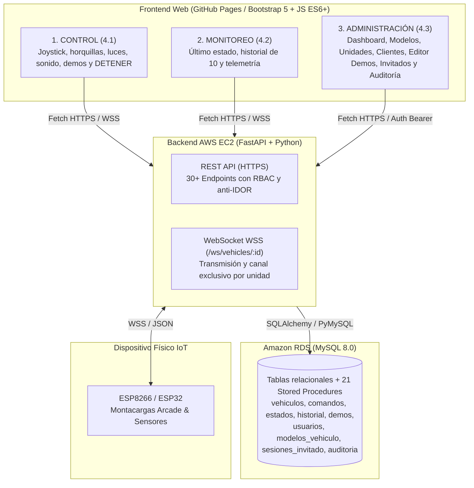
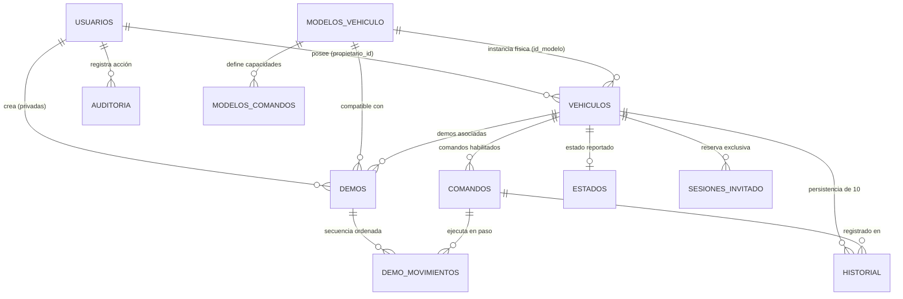

# Plataforma Comercial IoT · Control, Monitoreo y Administración (4.3)

Aplicación web integral multiusuario para la gestión comercial, operación, telemetría y demostración de vehículos IoT conectados a Amazon Web Services (AWS EC2 y Amazon RDS MySQL).

**Desarrollado por:** Ingrid Hernández Gómez · 2026  
**Publicación en GitHub Pages:** [https://ingriis.github.io/control-iot/](https://ingriis.github.io/control-iot/)  
**Documentación Swagger Backend:** `https://vehiculo-iot-ingrid.duckdns.org/docs`

---

## 1. Arquitectura General del Sistema

La solución integra tres módulos en un único frontend responsivo (Mobile First):



---

## 2. Matriz de Roles y Reglas de Negocio (RBAC)

| Módulo / Función | ADMINISTRADOR (Empresa) | USUARIO (Comprador) | INVITADO (Prospecto) |
|---|:---:|:---:|:---:|
| **Dashboard y KPIs Comerciales** |  Total | ❌ Denegado | ❌ Denegado |
| **Catálogo de Modelos (CRUD)** |  Total | 👁️ Solo lectura | 👁️ Solo lectura |
| **Inventario de Unidades Físicas** |  Total (Altas y Renombrar) | ❌ Denegado | ❌ Denegado |
| **Asignación de Comprador / Estado** |  Total | ❌ Denegado | ❌ Denegado |
| **Bitácora de Auditoría** |  Consulta | ❌ Denegado | ❌ Denegado |
| **Módulo «Mis Vehículos»** | 👁️ Todos |  Solo propias | ❌ Denegado |
| **Operación en CONTROL** | ⚠️ Requiere soporte en vendidas |  Solo unidades propias | ⚠️ Limitado a unidad de exhibición |
| **Lectura en MONITOREO** |  Auditoría |  Solo unidades propias | ❌ Denegado |
| **Editor de DEMOS (Crear/Quitar pasos)** |  Total (Fábrica y Soporte) |  Creación y edición (Propias) | ❌ Denegado |
| **Prueba de Exhibición con Reserva** | 👁️ Monitoreo | ❌ (Usa sus unidades) |  Reserva exclusiva temporal (3 min) |

> **Aislamiento por Recurso (Anti-BOLA/IDOR):** FastAPI valida en cada petición que el `id_usuario` autenticado coincida con el `propietario_id` de la unidad física solicitada. Si se altera el `vehicle_id` desde DevTools o Postman, el backend responde con **`403 Forbidden`**.

---

## 3. Diagrama Entidad-Relación y Migraciones SQL



### Scripts de Migración Versionados (en `work/.../migrations/`):
* `001_initial_backup_verification.sql`: Validación previa de registros y procedimiento de respaldo `mysqldump`.
* `002_migration_up_v3.sql`: DDL incremental para crear `usuarios`, `modelos_vehiculo`, `modelos_comandos`, `sesiones_invitado`, `auditoria` y extender `vehiculos` y `demos` de forma no destructiva.
* `003_migration_down_v3.sql`: Plan de reversión seguro para entornos de prueba.

> **Advertencia de MySQL:** En MySQL, cualquier sentencia DDL realiza un **commit implícito**, por lo que no es posible confiar en un `ROLLBACK` transaccional si falla un `ALTER TABLE`.

---

## 4. Indicadores de Conectividad Independientes

La barra superior muestra tres comprobaciones de red independientes:
1. **WebSocket WSS · navegador:** Indica si el cliente web mantiene la conexión activa en tiempo real (`online`, `reconnecting` o `disconnected`). *No certifica que el microcontrolador físico esté encendido.*
2. **Servidor AWS · API:** Consulta periódica a `/health` (`available` o `unavailable`).
3. **Amazon RDS:** Consulta a `/health/database` que ejecuta un `SELECT 1` directo en la base de datos MySQL en AWS (`disponible`, `no disponible` o `sin verificar`).

---

## 5. Matriz de Casos de Prueba (P01 – P17)

| Código | Prueba | Rol Evaluado | Resultado Esperado | Clasificación |
|---|---|---|---|:---:|
| **P01** | Login de Administrador | Administrador | Genera token Bearer, muestra menú comercial y oculta opciones de invitado | **Correcto** |
| **P02** | Alta de nueva unidad física | Administrador | Valida modelo comercial, número de serie único y persiste en RDS | **Correcto** |
| **P03** | Alta de cliente comprador | Administrador | Guarda usuario con contraseña hasheada y rol `USUARIO` | **Correcto** |
| **P04** | Asignación comercial de unidad | Administrador | Asigna vehículo a comprador, cambia estado y registra en auditoría | **Correcto** |
| **P05** | Aislamiento de comprador | Usuario | Usuario solo visualiza sus unidades en el selector «Mis vehículos» | **Correcto** |
| **P06** | Control manual de movimientos | Usuario | Envío de comandos al vehículo propio y acuse de aceptación | **Correcto** |
| **P07** | Telemetría WSS en tiempo real | Usuario | Eventos de movimiento recibidos instantáneamente por WebSocket | **Correcto** |
| **P08** | Historial limitado a 10 | Usuario | Monitoreo conserva únicamente los diez movimientos más recientes | **Correcto** |
| **P09** | Editor de DEMO persistente | Usuario | Guarda nombre, descripción y pasos en RDS vía API | **Correcto** |
| **P10** | Ejecución y DETENER de DEMO | Usuario | Ejecución con prioridad de DETENER para parada inmediata | **Correcto** |
| **P11** | Prueba de Invitado | Invitado | Catálogo público y solicitud de sesión de 3 minutos | **Correcto** |
| **P12** | Rechazo de acceso a Invitado | Invitado | Intento de consultar endpoints administrativos devuelve `401`/`403` | **Correcto** |
| **P13** | Rechazo de vehículo ajeno | Usuario | Envío de comando a vehículo no asignado devuelve `403 Forbidden` | **Correcto** |
| **P14** | Exclusividad de control | Invitado / Usuario | Segunda sesión simultánea en unidad de exhibición recibe `409 Conflict` | **Correcto** |
| **P15** | Reconexión y reconciliación | Todos | Al reconectar WSS se reconcilia el último estado con REST | **Correcto** |
| **P16** | Diseño responsivo Mobile First | Todos | Interfaz adaptable a celulares, tabletas y computadoras | **Correcto** |
| **P17** | Registro en Auditoría | Administrador | Verificación de bitácora con actor, acción, recurso y fecha | **Correcto** |

---

## 6. Variables de Entorno del Backend (AWS EC2)

* `DB_HOST`: Endpoint de la instancia Amazon RDS MySQL.
* `DB_PORT`: Puerto de conexión a MySQL (3306).
* `DB_NAME`: Nombre de la base de datos (`vehiculo_iot`).
* `DB_USER`: Usuario con privilegios de ejecución y DDL en RDS.
* `DB_PASSWORD`: Contraseña de base de datos (secreta, no en repositorio).
* `JWT_SECRET_KEY`: Llave criptográfica para firma de tokens HMAC-SHA256.
* `API_KEY`: Clave fija para compatibilidad con endpoints heredados.
* `CORS_ORIGINS`: Lista separada por comas de orígenes permitidos (`https://ingriis.github.io,http://localhost:8081`).

---

## 7. Instrucciones de Ejecución Local

### Frontend:
```powershell
cd frontend
py server/serve.py
# Abrir en el navegador http://localhost:8081
```

### Backend:
```powershell
cd work/vehiculo-iot-api-cors/vehiculo-iot-api
py -m venv .venv
.\.venv\Scripts\Activate.ps1
pip install -r requirements.txt
python -m app.main
# Swagger interactivo en http://127.0.0.1:8000/docs
```
